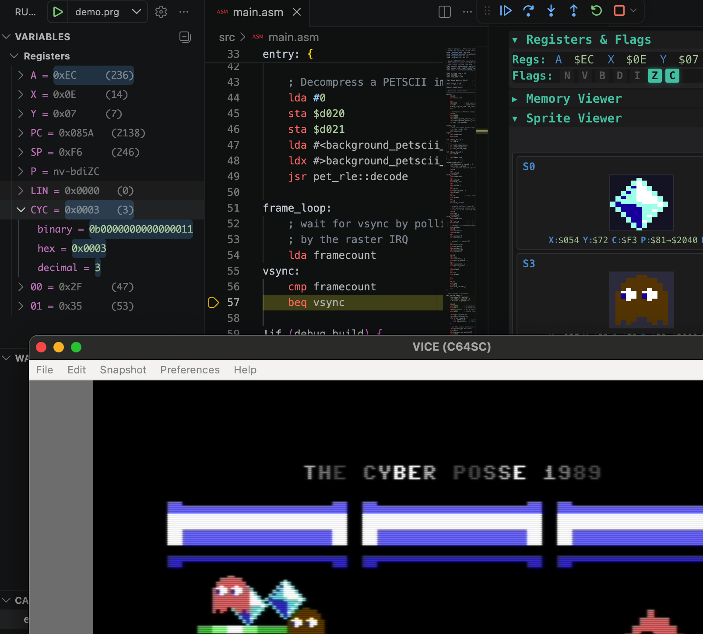
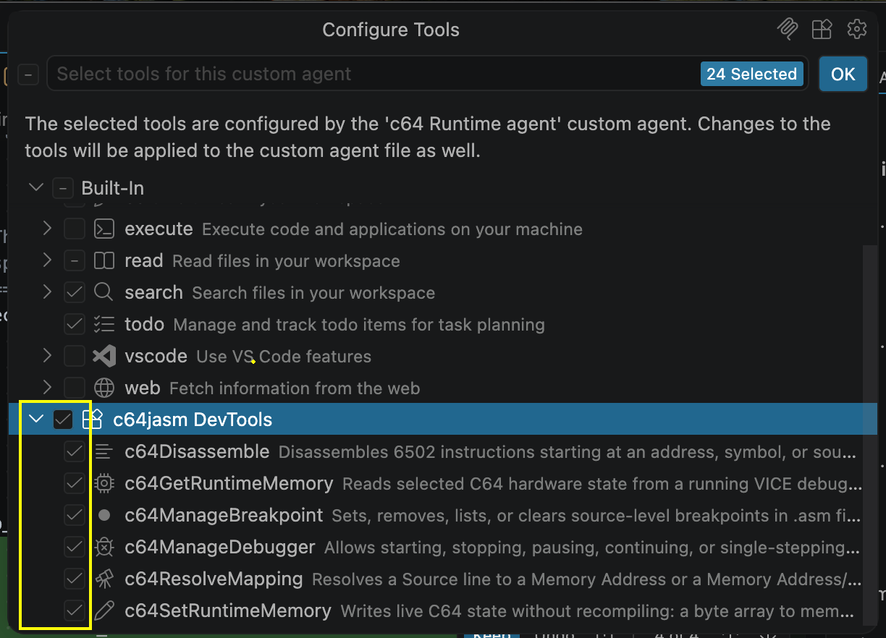

# c64jasm DevTools



Originally created by Janne Hellsten, who conceived [c64jasm](https://nurpax.github.io/c64jasm/) as a JavaScript-extensible assembler and developed both the assembler and the VS Code extension. 

In 2022, Luca began improving the extension by adding advanced debugging capabilities (such as the C64 runtime inspector) and rich code navigation features (like Find All References, Go to Definition, and hovers for well-known C64 memory addresses). Additionally, if you have a GitHub Copilot subscription, the debugger is fully integrated with the Copilot agent. The agent can read and write C64 memory, view the screen as an image, and actively assist you in developing new features or fixing bugs.

The same six debugger tools are also available through a [standalone MCP server](#standalone-mcp-server-codex-and-other-mcp-clients) for Codex and other MCP clients. It includes the c64jasm compiler and launches VICE directly. You can use it with Node.js 20+ and VICE, independently of VS Code or a Copilot subscription.

In 2026, this work is being published as a new extension with id `c64jasm-devtools`. This extension adds first-class c64jasm support to VS Code with:

- Syntax highlighting and auto-completion for c64jasm source files
- Real-time compile diagnostics while you edit
- Rich Code Navigation: Go to Definition, Find All References, and Workspace Symbol Search
- Contextual Hovers for symbols and well-known C64 memory map addresses
- Build and run/debug workflows for Commodore 64 projects with project scaffolding
- Integrated C64 runtime/debug tooling for VICE-based sessions (breakpoints, CPU/Memory/VIC/SID inspection)
- AI-assisted debugging through MCP in VS Code, or the standalone stdio server for Codex CLI and other compatible clients

## Requirements

For the VS Code extension:

- VS Code 1.102.0 or newer (extension engine `^1.102.0`), with MCP server provider support
- VICE installed and available in PATH (defaults to `x64sc`), or configured explicitly via `c64jasm-devtools.vicePath`

By default, the extension uses the bundled `c64jasm` compiler. You can switch to a system-installed compiler with `c64jasm-devtools.useEmbeddedCompiler`.

## Quick Start

1. Open the Command Palette (`Ctrl+Shift+P` or `Cmd+Shift+P`) and run `c64jasm-devtools: Create New Project`.
2. Select the sample project and a destination folder. Choose to open it in VS Code right away.
3. Press `F5` to launch the debugging session. This will automatically compile your code and launch VICE for debugging using the default `c64jasm-debug` configuration created in `launch.json`.

If no custom debug configuration exists yet, use the provided `c64jasm-debug` launch configuration template.

## Extension Settings

This extension contributes the following settings:

* `c64jasm-devtools.maxNumberOfProblems`: Controls the maximum number of problems produced by the server. Defaults to `100`.
* `c64jasm-devtools.trace.server`: Traces communication between VS Code and the language server. Possible values: `off`, `messages`, `verbose`. Defaults to `off`.
* `c64jasm-devtools.useEmbeddedCompiler`: Enable or disable using the bundled `c64jasm` compiler. Defaults to `true`. If set to `false`, the extension will try to run the `c64jasm` executable from your system PATH.
* `c64jasm-devtools.vicePath`: Specifies the path to the VICE executable used when starting a debug session. Defaults to `x64sc`.
* `c64jasm-devtools.enableMcp`: Enable the extension-hosted MCP endpoint. Defaults to `true`.
* `c64jasm-devtools.allowExternalMcpClients`: Allow explicit connections from external MCP clients to that endpoint. Defaults to `false`.
* `c64jasm-devtools.disableCopilotIntegration`: Disable automatic Copilot MCP discovery, the `Update Copilot Assets` command, the post-update reminder, and deployment of Copilot agents, skills, and instructions into new projects. Defaults to `false`. Changing it takes effect after reloading the window. This does not disable the generic MCP endpoint or explicitly enabled external access.
* `c64jasm-devtools.notifyToUpdateCopilotAssets`: After the extension updates to a new version, show a reminder to refresh the bundled Copilot assets (agents and skills) in your project. Defaults to `true`. The reminder can also be dismissed permanently via its "Don't Show Again" action.

## AI Debugger Tools

All six tools below are exposed **only through MCP**; no duplicate native VS Code tools are registered. Describe what you want to inspect or change, and the agent can invoke them.

The extension hosts an authenticated loopback **Streamable HTTP** MCP endpoint labeled `c64jasm`, automatically contributed through provider ID `c64jasm`. It controls the same `F5`/debug UI session and editor breakpoints, not a separate VICE session. Screenshots retain PNG image results, file output, and clipboard capture. For independent CLI sessions, use the [standalone stdio server](#standalone-mcp-server-codex-and-other-mcp-clients).

* `c64jasm_manageDebugger`: Start, stop, pause, continue, step into, step over, step out, or check status of a C64 debug session.
  > *"Start the C64 debug session"* — or — *"Step over the next instruction"*
* `c64jasm_manageBreakpoint`: Set, remove, list, or clear source breakpoints in `.asm` files, with optional VICE breakpoint conditions.
  > *"Set a breakpoint at line 42 of main.asm"* — or — *"Remove all breakpoints in player.asm"*
* `c64jasm_getRuntimeC64Memory`: Read runtime C64 state from VICE (CPU, VIC, SID, CIA, memory ranges, symbols) and optionally capture a screenshot.
  > *"Show me the current VIC registers"* — or — *"Read 16 bytes at $C000 and take a screenshot"*
* `c64jasm_resolveMapping`: Resolve a source file and line to a C64 memory address, or vice versa, using the static map created by the compiler (without needing to pause execution).
  > *"What memory address corresponds to line 100 in main.asm?"*
* `c64jasm_setRuntimeC64Memory`: Write bytes directly into the C64 RAM and/or set CPU registers (PC, A, X, Y, SP, P) while the emulator is running, targeting an address, symbol, or a line of code. Enables live-tweaking and validating fixes without recompiling.
  > *"Write values 0, 10, 5 to $D020 to change the border and background colors"* — or — *"Set PC to the `main_loop` label"*
* `c64jasm_disassemble`: Disassemble 6502 instructions at an address, symbol, or source line — either the bytes currently live in RAM (reflecting runtime pokes and self-modifying code) or from the static compiled image.
  > *"Disassemble 8 instructions at the `irq_handler` symbol"*

### Copilot runtime agent

Use the `C64 Runtime agent` with the `c64-runtime` skill to step through code and investigate a problem. For example, pause a debug session in the Content-pipe sample (created with `c64jasm-devtools: Create New Project`) and ask:

> *"@c64-runtime-agent why are the ghosts blue? I expected them to be white or grey. The debug session is paused, check this out by stepping through the code."*

### Project Copilot assets

When you create a project with `c64jasm-devtools: Create New Project`, the extension provisions the workspace's `.github/` folder with the C64 Runtime agent, the `c64-runtime` skill, and a `copilot-instructions.md`. Those instructions tell Copilot how the project is validated: the c64jasm language server recompiles on every edit and reports the compiler's errors to the **Problems** panel, so there is no build task to run. After an extension update you can refresh the bundled agent and skill via the `c64jasm-devtools: Update Copilot Assets` command — your project's `copilot-instructions.md` is left untouched. All of this provisioning can be turned off with the `c64jasm-devtools.disableCopilotIntegration` setting.

### Copilot availability

Copilot tools require Copilot Chat access and a VS Code version with MCP server provider support. The `c64jasm` server is discovered automatically when MCP is enabled and `disableCopilotIntegration` is `false`; no manual `mcp.json` entry is needed. Check **MCP: List Servers** and enable its tools through **Chat: Configure Tools** or the chat tools picker. Follow any trust or permission prompts.

The bundled runtime agent uses `c64jasm/*`, following VS Code's [`<server name>/*` convention](https://code.visualstudio.com/docs/agents/reference/custom-agent-file-reference#tools). Clients that do not support MCP server wildcards require their own tool-selector syntax. Refresh existing projects with **Update Copilot Assets** to replace old native-tool selectors; project instructions remain untouched.



Learn more:
- [Using Tools in Copilot Chat](https://code.visualstudio.com/docs/copilot/copilot-chat#_using-tools)
- [Chat Agent Mode](https://code.visualstudio.com/docs/copilot/chat/chat-agent-mode)

## Connect external clients to the VS Code session

Use a client supporting **Streamable HTTP and authentication headers**; not every MCP client supports this transport.

1. Keep `c64jasm-devtools.enableMcp` enabled and explicitly set `c64jasm-devtools.allowExternalMcpClients` to `true`.
2. Run **c64jasm-devtools: Copy MCP Connection Details** (`c64jasm-devtools.copyMcpConnection`).
3. Configure the client with the copied endpoint URL and authentication header. Keep VS Code open to use its debugger session.

This command intentionally copies credentials to the clipboard. Treat them as secrets: do not share or commit them. The port and token are per activation and expire on window reload; copy fresh details after reloading.

For remote extension hosts, the connection command initially shows a clear unsupported warning. The extension host's loopback endpoint is not automatically forwarded to the local machine.

Choose the transport/backend explicitly; there is no client-name detection or automatic fallback. For stdio-only clients or Codex CLI without VS Code, use the standalone server below.

## Standalone MCP server (Codex and other MCP clients)

For Codex CLI without VS Code, the primary setup is the [`c64jasm-devtools-mcp` server](mcp/README.md), which exposes all six tools over MCP stdio. It
manages a compiler watcher and its own VICE debug session, and returns screenshots
and sprite images as MCP image content. It does not attach to VS Code's session.

Agents start, pause, resume, and stop the session through
`c64jasm_manageDebugger`. The server controls VICE directly through its binary
monitor, with one VICE session per MCP server process. See
[session control](mcp/README.md#session-control) for the actions and process lifecycle.

The `c64jasm-devtools-mcp` npm package embeds the same forked compiler as the extension,
including its server mode and JavaScript dependencies. Users install only the
MCP package, Node.js, and VICE. See [installation](mcp/README.md#install) for
tarball installation and the npm distribution plan; no separate forked
`c64jasm` package needs to be published.

### Requirements

- Node.js 20 or later.
- VICE with binary monitor support, with `x64sc` on PATH or supplied through
  `--vice-path`.
- A c64jasm project with a BASIC `SYS` startup header, as used by the samples.

### Build and connect Codex

From a fresh checkout, run these commands at the repository root to prepare the
bundled compiler and build the server:

```sh
npm ci
node scripts/vendor-core.js
cd vscode
npm install
npm --prefix mcp ci
npm run compile:mcp
```

Register the built server with Codex, replacing the server and project paths
with absolute paths:

```sh
codex mcp add c64jasm -- node /absolute/path/to/c64jasm/vscode/mcp/dist/index.cjs --project /absolute/path/to/c64-project
codex mcp list
```

Append `--vice-path /absolute/path/to/x64sc` to the server command to select a
VICE executable explicitly. Start a new Codex session after registering the
server; `/mcp` in the Codex CLI shows its tools. See the
[official Codex MCP documentation](https://developers.openai.com/codex/mcp) for
client configuration.

### Configure and debug a project

The server reads `c64jasm.json` in the directory selected by `--project`:

```json
{ "source": "src/main.asm" }
```

Without that file, it uses `main.asm`. The default build outputs are
`out/<source-name>.prg` and `out/<source-name>.disasm`. A start request can
override the paths or select an existing `c64jasm-debug` entry in
`.vscode/launch.json` through `configName`.

For example, ask Codex:

- "Start the C64 debugger and pause at entry."
- "Set a breakpoint at line 42 of src/main.asm, then continue."
- "Read the CPU registers and show a screenshot."
- "Disassemble eight instructions at the main_loop symbol."

Reading runtime state pauses execution; use `continue` to resume. The compiler
watches source changes; restart the debug session to load a new build into
VICE. Closing the MCP connection stops the server's compiler watcher and VICE
process.

The built `mcp/dist/` directory can be copied to another machine and run with
Node.js and VICE. See the [MCP server README](mcp/README.md) for `config.toml`
examples, tool parameters, packaging, and the `npm run test:mcp` validation
command.

